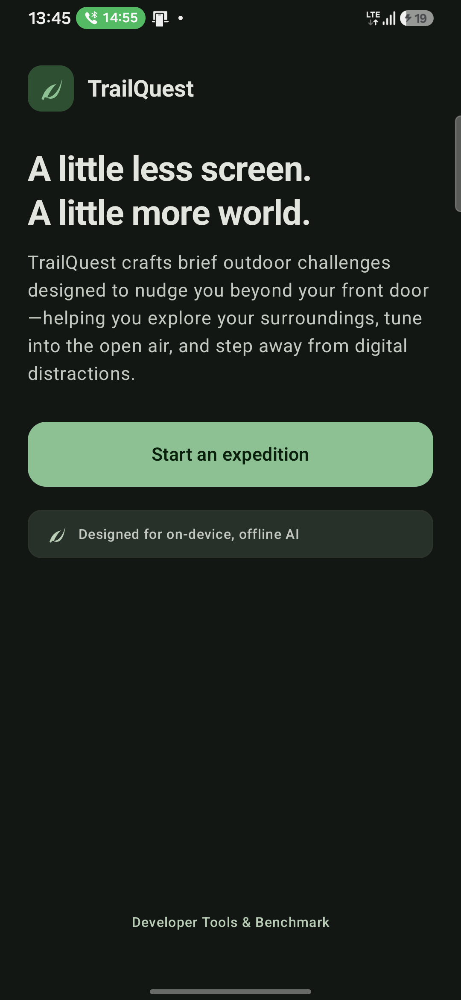
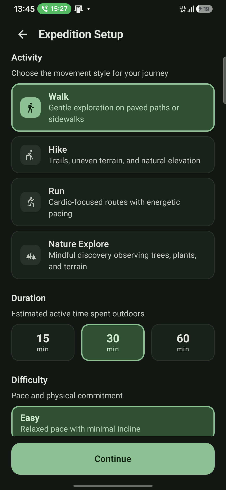
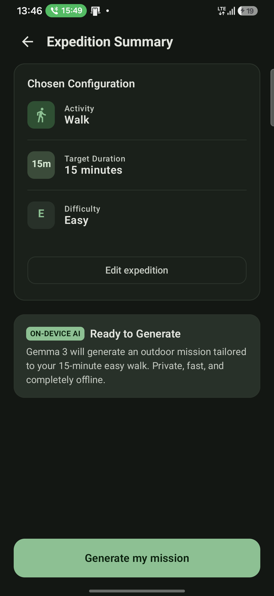
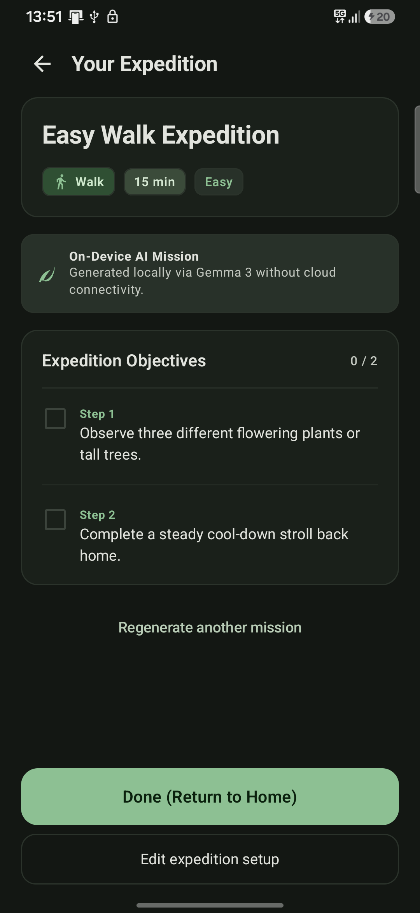
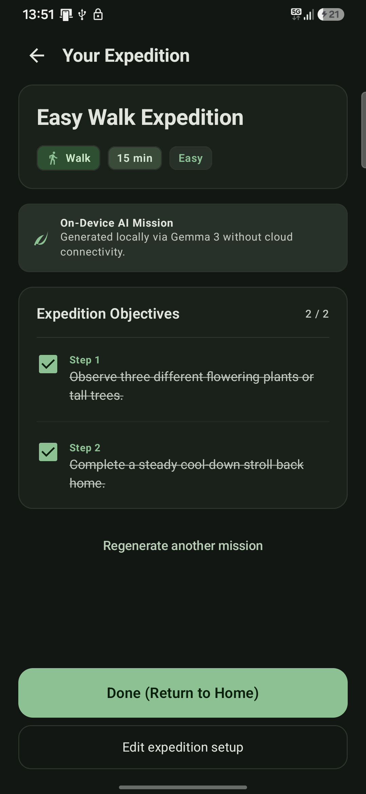
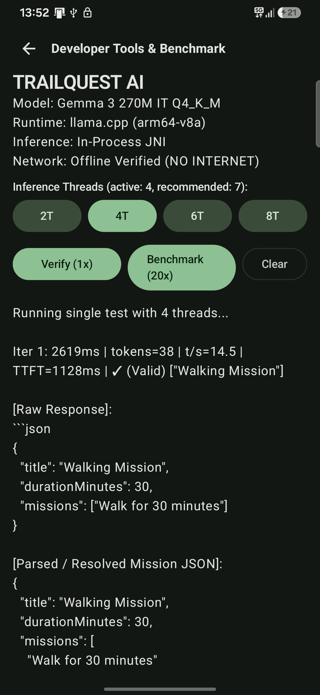
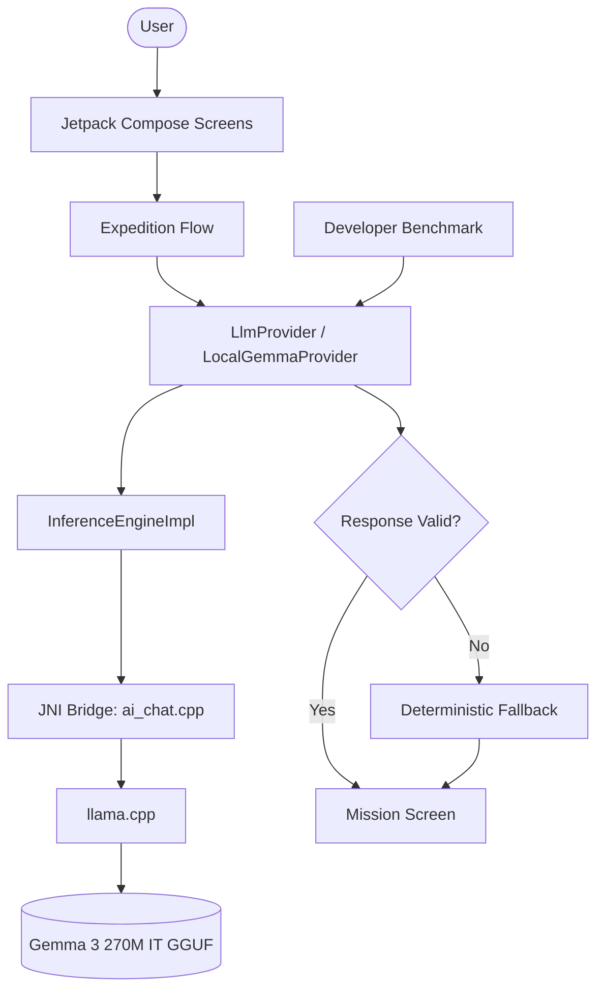

# TrailQuest 🌿

On-device AI that generates outdoor exploration missions -- helping you spend less time on screens and more time outside.

TrailQuest creates guided outdoor activity prompts tailored by activity type, duration, and difficulty. Designed for walkers, hikers, runners, and nature enthusiasts, it runs a compact large language model entirely on your Android device. All generation happens locally and offline without cloud servers, cellular connectivity, or GPS route tracking.

---

## Screenshots

Captured from physical device testing on a Samsung Galaxy F34 5G (`arm64-v8a`):

|               Home Screen               |                Expedition Setup                |                Expedition Review                |
| :--------------------------------------: | :--------------------------------------------: | :----------------------------------------------: |
|  |  |  |

|                      Generated Mission                      |                      Completed Mission                      |                      Developer Benchmark                      |
| :---------------------------------------------------------: | :---------------------------------------------------------: | :------------------------------------------------------------: |
|  |  |  |

---

## Core Features

- **Activity Types:** Walk, Hike, Run, and Nature Explore.
- **Flexible Durations:** 15, 30, and 60 minutes.
- **Difficulty Tiers:** Easy, Moderate, and Challenging with distinct pacing and goals.
- **On-Device Inference:** Gemma 3 270M IT running locally via in-process `llama.cpp` through JNI.
- **Schema Validation & Fallbacks:** Strict JSON validation with 36 deterministic offline fallbacks covering every permutation.
- **Developer Tools:** In-app benchmark screen with configurable inference thread count.
- **Zero Required Permissions:** No Android network (`INTERNET`) or location (`ACCESS_*_LOCATION`) permissions.

---

## Architecture



- **Lazy initialization:** The LLM provider and native runtime remain uninstantiated until mission generation or benchmarking begins.
- **Serialized inference:** Execution is serialized through `LocalGemmaProvider` transactions protected by a coroutine mutex.
- **Deterministic fallbacks:** Structured response validation intercepts invalid or non-compliant outputs and substitutes an offline fallback mission.

---

## Quick Start

### Prerequisites

- JDK 17 & Android SDK API 36 (`compileSdk`, `targetSdk`)
- CMake 3.22.1 & NDK 27+
- Python 3.8+ (for model verification script)
- Physical ARM64 device (`arm64-v8a`, Android 7.0+ / API 24+) for native LLM execution

### Build & Run (PowerShell)

```powershell
git clone --recurse-submodules https://github.com/Omiiii04/TrailQuest.git
cd TrailQuest
python scripts/fetch_model.py
.\gradlew.bat testDebugUnitTest
.\gradlew.bat assembleRelease
adb install -r "app\build\outputs\apk\release\app-release.apk"
```

`scripts/fetch_model.py` downloads or validates the model file into `app/src/main/assets/models/`:

- **Model:** Gemma 3 270M IT, `Q4_K_M` GGUF
- **Exact Size:** 253,114,880 bytes
- **Pinned Revision:** `88762a3700deaf5b03184019806c88dc9b5c8876`
- **SHA-256:** `55aed1673d2f3014a739732c659c4995fc57abf6e4e9c68462fb2ceee820ea2f`

The release build outputs to `app/build/outputs/apk/release/app-release.apk`. Building a signed release requires release keystore credentials in `local.properties` or environment variables (`RELEASE_STORE_FILE`, `RELEASE_STORE_PASSWORD`, `RELEASE_KEY_ALIAS`, `RELEASE_KEY_PASSWORD`). Never commit private keys or credentials to version control.

---

## Verified Results

The following figures reflect recorded verification for implementation commit `0c537f8`:

| Check                           | Result                                                      |
| ------------------------------- | ----------------------------------------------------------- |
| **Implementation Commit** | `0c537f8`                                                 |
| **Unit Tests**            | 63 passed (0 failures, 0 errors, 0 skipped across 8 suites) |
| **Release Build**         | Successful                                                  |
| **Physical Device**       | Samsung Galaxy F34 5G                                       |
| **Native ABI**            | `arm64-v8a` only                                          |
| **Release APK Size**      | 403,727,280 bytes (403.7 MB / 385.0 MiB)                    |
| **Android Permissions**   | Zero network or location permissions                        |

### Performance Summary

- **Benchmark Run (4 threads):** Time to First Token (TTFT) 1128 ms, throughput 14.51 tokens/s, 38 tokens generated in 2619 ms.
- **End-to-End Generation:** Approximately 6.4 seconds for a 15-minute Easy Walk mission (includes full Android ViewModel coordination, prompt building, token generation, and UI state transition, distinct from raw benchmark inference).

For historical baseline runs and complete testing methodology, see [`docs/benchmark-template.md`](docs/benchmark-template.md).

---

## Privacy & Limitations

- **Completely Offline:** Inference executes entirely on-device; no data leaves the phone.
- **Zero Permissions:** `AndroidManifest.xml` requests no network (`INTERNET`) or location permissions.
- **Hardware Requirement:** Targets `arm64-v8a` with NEON optimizations; standard x86/x86_64 emulators are unsupported.
- **Package Size:** The APK is 403.7 MB because the 253.1 MB GGUF model is bundled uncompressed in app assets for out-of-the-box offline use.
- **Model Edge Cases:** Gemma 3 270M IT is a compact edge model. Minor schema variations are safely resolved by the deterministic fallback system.

---

## Attribution

- **Gemma 3:** Provided under the [Gemma Terms of Use](https://ai.google.dev/gemma/terms). See [`docs/GEMMA_TERMS_OF_USE.md`](docs/GEMMA_TERMS_OF_USE.md).
- **llama.cpp:** [MIT License](https://github.com/ggerganov/llama.cpp/blob/master/LICENSE) (Georgi Gerganov and contributors).
- **GGUF Model Weights:** Hosted by [gguf-org/gemma-3-270m-it-gguf](https://huggingface.co/gguf-org/gemma-3-270m-it-gguf) on Hugging Face.
- **AndroidX & Jetpack Compose:** [Apache License 2.0](https://www.apache.org/licenses/LICENSE-2.0).
